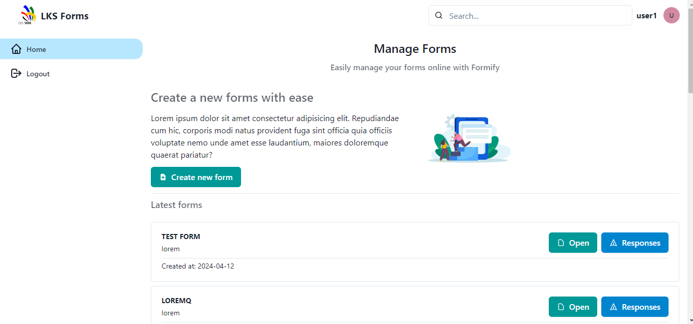

# Formify

Formify is a dynamic form builder, similar to a minimal Google Forms. I built it in April 2024 as practice for the **LKS (Lomba Kompetensi Siswa) Web Technology** competition, provincial level, following the official 2024 grid (kisi-kisi).

Users can create forms with several question types (short answer, paragraph, date, multiple choice, dropdown, checkboxes), share the form link, collect responses, and view all submitted responses. Forms can be limited to specific email domains and to one response per user.

> This is a practice project for a competition. It is not maintained and is not intended for production use.

## Repository structure

```
formify/
├── backend/    REST API (Laravel 11 + Sanctum)
└── frontend/   Single-page app (React + Vite + Chakra UI)
```

## Tech stack

| Part     | Stack                                                    |
| -------- | -------------------------------------------------------- |
| Backend  | PHP 8.2, Laravel 11, Laravel Sanctum, MySQL              |
| Frontend | React 18, Vite 5, React Router 6, Chakra UI 2, Axios     |

## Getting started

### Requirements

- PHP 8.2+ and Composer
- MySQL
- Node.js 18+ and npm

### 1. Backend

```bash
cd backend
cp .env.example .env        # then set your DB_* values
composer install
php artisan key:generate
php artisan migrate
php artisan db:seed --class="UserSeeder"
php artisan serve
```

The API runs at `http://127.0.0.1:8000/api/v1`.

### 2. Frontend

```bash
cd frontend
cp .env.example .env        # point VITE_API_BASE_URL to the backend
npm install
npm run dev
```

### Default accounts

The seeder creates two users:

| Email              | Password   |
| ------------------ | ---------- |
| user1@webtech.id   | `password` |
| user2@webtech.id   | `password` |

## API endpoints

All endpoints use the `/api/v1` prefix. Every endpoint except login needs a Sanctum bearer token.

| Method | Endpoint                                   | Description              |
| ------ | ------------------------------------------ | ------------------------ |
| POST   | `/auth/login`                              | Log in, returns a token  |
| GET    | `/auth/logout`                             | Log out                  |
| GET    | `/forms`                                   | List the user's forms    |
| POST   | `/forms`                                   | Create a form            |
| GET    | `/forms/{form_slug}`                       | Form detail              |
| POST   | `/forms/{form_slug}/questions`             | Add a question           |
| PUT    | `/forms/{form_slug}/questions`             | Update questions         |
| DELETE | `/forms/{form_slug}/questions/{id}`        | Remove a question        |
| GET    | `/forms/{form_slug}/responses`             | List responses           |
| POST   | `/forms/{form_slug}/responses`             | Submit a response        |

## Competition grid

The official LKS 2024 grid (kisi-kisi) is in [`frontend/public/kisi-kisi.pdf`](frontend/public/kisi-kisi.pdf).

## License

[MIT](LICENSE) © 2024 Andika Dwi Saputra
